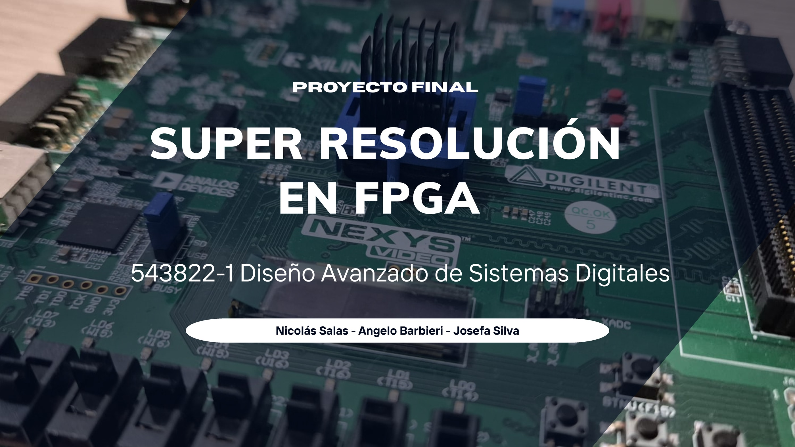
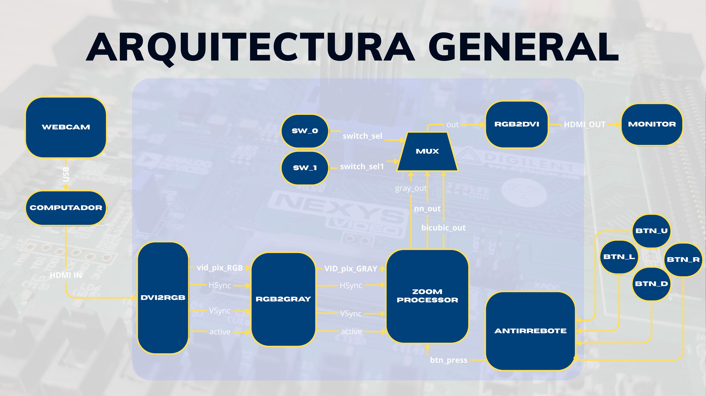
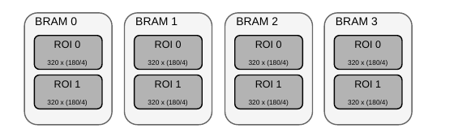
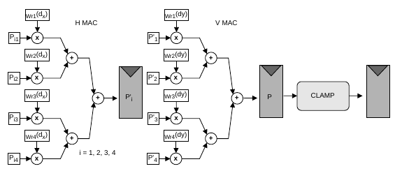
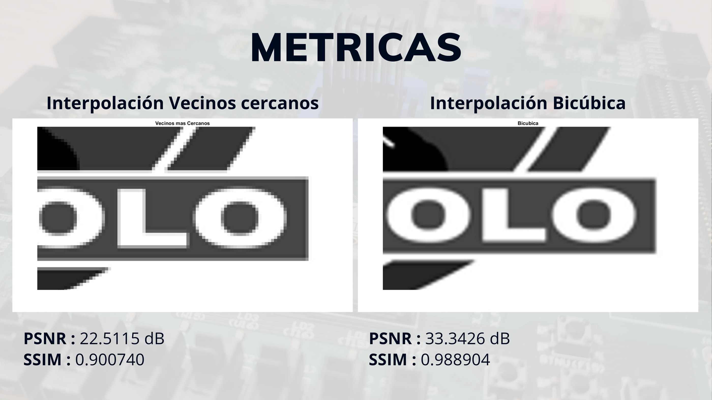

# Ampliación de imágenes en FPGA: interpolación bicúbica y vecino más cercano

**Nexys Video · SystemVerilog · HDMI · Procesamiento de imágenes · MATLAB**

Sistema de ampliación de una región de interés móvil de **320 × 180 píxeles** hacia una salida de **1280 × 720 píxeles**, con aumento de 4× por eje. Permite comparar interpolación bicúbica y vecino más cercano sobre video en escala de grises.

**[Leer informe](docs/informe-super-resolucion.pdf) · [Descargar informe original](docs/informe-super-resolucion.pdf?raw=true) · [Descargar presentación](docs/presentacion-super-resolucion.pdf?raw=true)**

## Qué se construyó

El proyecto implementa un flujo de adquisición, almacenamiento, interpolación y despliegue de video sobre una **Nexys Video con Artix-7 XC7A200T**. El usuario puede mover la región de interés mediante cuatro pulsadores y alternar entre la vista original, vecino más cercano y bicúbica mediante interruptores.

El título académico utiliza el término «super resolución». El método implementado es ampliación por interpolación espacial: no incorpora un modelo de aprendizaje ni demuestra recuperación de detalle ausente en la imagen de entrada.

## Arquitectura del sistema

*Diapositiva 6 de la presentación original. Muestra la integración del procesamiento con los controles físicos y la salida de video.*

### 1. Adquisición e interacción

La entrada HDMI se decodifica mediante `dvi2rgb`. El módulo `rgb2gray` convierte RGB de 24 bits a luminancia de 8 bits mediante la aproximación `(77R + 150G + 29B) / 256`. Las multiplicaciones, suma y desplazamiento se distribuyen en dos ciclos.

Los botones se sincronizan y filtran con un `debouncer` de 20 ms. Cada pulsación válida desplaza la ROI en pasos de 20 píxeles, dentro de los límites del cuadro. Un recuadro blanco de dos píxeles señala la región seleccionada en la vista original.

### 2. Memoria y ventana de procesamiento

*Figura 3 del informe, página 3. La distribución por filas permite obtener las cuatro filas requeridas por la interpolación.*

La ROI se distribuye en cuatro bancos lógicos según `fila % 4`. Cada banco tiene doble buffer: mientras se captura el cuadro actual, se procesa el anterior completo. El sistema introduce así un cuadro de retraso y evita mezclar datos de dos cuadros durante la lectura.

Una ventana de 4 × 4 píxeles proporciona las 16 muestras necesarias para la interpolación bicúbica. La ventana se mantiene durante cuatro ciclos horizontales, variando la fase del interpolador para producir cuatro píxeles de salida.

### 3. Interpolación y sincronización

*Figura 5 del informe, página 3. La segmentación separa el cálculo horizontal, el vertical y la saturación de salida.*

La bicúbica utiliza el kernel de Keys con `a = -0.5`, coeficientes con signo en Q2.7 y saturación final a `[0, 255]`. Su pipeline tiene tres etapas: H MAC, V MAC y CLAMP. El vecino más cercano conserva la misma latencia mediante registros.

El informe describe **ocho ciclos de latencia de procesamiento**, incluyendo direccionamiento, lectura de memoria y carga de ventana, además del retraso de cuadro del doble buffer. Las señales de sincronización se retrasan para alinearlas con los datos. El reloj de trabajo es de **74,25 MHz**, con un píxel de salida por ciclo durante el flujo activo.

## Resultados documentados

*Diapositiva 16. La bicúbica suaviza los bordes del caso de prueba, mientras que el vecino más cercano conserva escalones visibles.*

| Métrica | Vecino más cercano | Bicúbica |
|---|---:|---:|
| PSNR | 22,5115 dB | 33,3426 dB |
| SSIM | 0,900740 | 0,988904 |

Son resultados del caso de prueba descrito en el informe, obtenidos con simulación Verilog y evaluación en MATLAB. No representan un promedio sobre un conjunto amplio de imágenes. Se usa el valor de PSNR de la tabla I y de la presentación; la conclusión del PDF contiene una discrepancia tipográfica para vecino más cercano (`22,5225 dB`).

| Recurso | Utilizado | Porcentaje reportado |
|---|---:|---:|
| LUT | 1.969 | 1,47 % |
| Flip-flops | 947 | 0,35 % |
| BRAM | 32 | 8,77 % |
| DSP | 4 | 0,54 % |

El informe reporta WNS de **0,455 ns** y potencia total de **0,602 W** (0,447 W dinámica y 0,155 W estática). La potencia corresponde a la estimación de implementación documentada. Los cuatro bancos lógicos se distribuyen entre 32 primitivas BRAM; no son cuatro bloques físicos.

## Mi contribución y equipo

Las responsabilidades de la sección V del informe distinguen las contribuciones de cada integrante:

| Integrante | Responsabilidad documentada |
|---|---|
| **Nicolás Salas** | Adquisición y despliegue de imagen; `rgb2gray`, `debouncer`, ROI dinámica y testbench de verificación RTL |
| Angelo Barbieri | Procesamiento espacial, interpolación bicúbica, vecino más cercano y apoyo en ROI dinámica |
| Josefa Silva | Simulación, evaluación de PSNR/SSIM en MATLAB y apoyo en validación |

Proyecto de Diseño Avanzado de Sistemas Digitales, Universidad de Concepción, Chile.

## Documentación disponible

- [Informe original, 5 páginas](docs/informe-super-resolucion.pdf): arquitectura, metodología, resultados y bibliografía.
- [Presentación, 21 diapositivas](docs/presentacion-super-resolucion.pdf): copia optimizada para lectura y descarga; conserva todas las diapositivas, con imágenes reducidas y compresión JPEG. El archivo fuente de aproximadamente 144 MB se conserva fuera de este repositorio.
- `assets/`: figuras del informe y diapositivas, con procedencia indicada en sus pies.
- `docs/SHA256SUMS.txt`: huellas de integridad de los PDF publicados.

El repositorio presenta el trabajo y su evidencia documental. Los fuentes HDL, proyecto Vivado, testbench y scripts MATLAB no se incluyen en esta entrega; por ello aún no constituye un paquete reproducible de síntesis y simulación. La diapositiva titulada «Resultado video» no contiene un video reproducible en este PDF.

## Otros proyectos

[Procesador RISC-V](https://github.com/TheNicolen/Dise-o-de-procesador-RISCV-multiciclo) · [Control PID](https://github.com/TheNicolen/Controlador-PID-de-Nivel-y-flujo-en-planta-de-un-estanque) · [Control adaptativo](https://github.com/TheNicolen/Tecnicas-de-control-adaptativo-de-planta-de-un-estanque)
